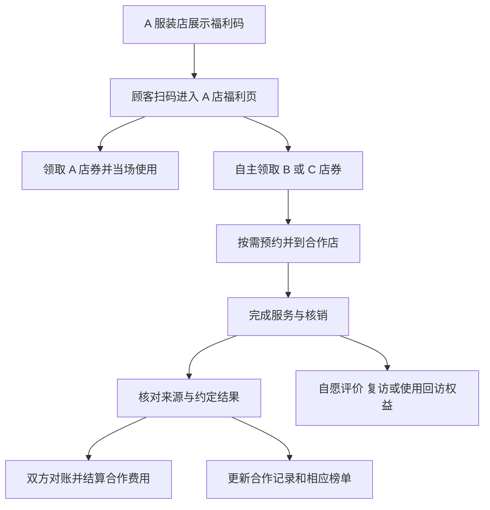

# 竹山同城产品与商业闭环完整方案

整理日期：2026 年 11 月 20 日  
版本：讨论整合稿 v1.0  
用途：判断产品价值、明确商家合作方式，并据此设计微信小程序。

**竹山同城面向本地居民和实体商家，提供有效的生活信息、可兑现的优惠和服务入口，并支持商家之间购买推广与拓客服务。** 居民更容易发现和选择本地服务；商家可以获得新客，也可以利用自己的门店入口为合作店引流；平台提供商家发现、优惠券、合作记录、排名、效果核对和对账。

本轮最明确的商业场景，是 A 服装店展示福利码，顾客扫码领取并当场使用 A 店券，同时自主领取美业、足浴等 B/C 店的券。各店可以免费互推，也可以直接向对方购买推广。门店福利码是整体产品的一个入口，便民信息、社区与活动仍有独立价值。

**当前判断：产品方向有合理性，商家互相购买拓客值得重点设计；实际到店提升、商家利润和平台盈利需要通过真实合作验证。** 原 PRD 的年费、分润比例和所有增长数字均不视为已验证结论。

## 1 已明确的设想和仍需判断的内容

| 内容 | 当前状态 | 应如何理解 |
|---|---|---|
| 开发竹山本地生活微信小程序 | 用户明确的目标 | 产品方案最终要落到功能和实际运营 |
| 便民信息 商家联盟 社区 | 原 PRD 的产品方向 | 保留各自价值，按条件分阶段建设 |
| 足浴店请外地团队发体验券并约客到店 | 用户提供的实际观察 | 至少该店愿意为拓客投入资源，收费方式与最终效果未知 |
| A 服装店扫码领本店券并当场核销 | 用户明确的使用场景 | A 自己的福利构成扫码理由 |
| 同时展示 B 美业 C 足浴等合作店优惠 | 用户明确的使用场景 | 顾客自主选择跨店领取和使用 |
| 各家店之间直接购买拓客服务 | 用户明确的商业方向 | 同一家店可购买推广，也可承接推广获得报酬 |
| 加入排名 | 用户明确的功能方向 | 排名对象与指标采用下文建议，仍可调整 |
| 回访权益 闲时名额 场景专题 单位福利 | 讨论中提出的扩展建议 | 根据商家供给和实际需求选择，不默认全部进入第一版 |
| 具体价格 费率 商家规模 月收入 | 尚未确定 | 用交付成本、商家收益和实际付款数据判断 |

“女性消费场景较多”和“县城店铺信息相对闭塞”是用户提出的重要观察。选店时还要看各店真实客群、价格、距离与服务能力；产品整体可进一步覆盖亲子、养车、居家服务等场景。

## 2 产品要解决的具体问题

### 2.1 居民遇到的问题

居民可能不知道附近有哪家店，不了解服务项目、价格和适用条件；看到优惠后，还可能担心限制多、商家不认券或到店无法接待。便民信息则容易遇到过期、已售已租、重复发布和联系不上。

因此，产品需要帮助居民完成一连串实际动作：**发现商家或信息，了解条件，决定是否领取或联系，预约并到店，遇到问题后得到处理。** 优惠只是其中一种促成行动的方式，及时的信息和可靠的服务同样构成价值。

### 2.2 商家遇到的问题

小商家需要被更多合适的本地顾客看见，但未必会持续运营内容、设计活动和追踪效果。有的店已有客流，却只能靠当前交易赚钱；有的店有服务能力和空闲时段，却缺少新顾客。

商家合作的机会在于：一部分店能够提供顾客接触入口，另一部分店愿意为相关推广或有效到店付费。同一家店在不同合作中可以同时承担这两种角色。

### 2.3 平台需要承担的工作

平台负责把可合作的店、清楚的优惠和明确的商业条件组织起来，并让来源、履约、费用和效果可以核对。还要有人维护商家资料、培训店员、处理无效优惠、纠正过期信息和处理争议。

小程序能提高这些工作的效率；真实商家供给、本地渠道和日常运营仍需要持续建设。

## 3 客户价值和选择理由

| 使用者 | 获得的实际价值 | 选择产品的理由 | 持续使用的条件 |
|---|---|---|---|
| 普通居民 | 本地有效信息 商家资料 优惠 活动 联系和预约 | 找得快、条件清楚、优惠能兑现、问题有人处理 | 内容及时，操作简单，不被频繁打扰 |
| 信息发布者 | 触达真实本地需求方 | 发布方便，有有效联系与状态反馈 | 信息没有被无关广告淹没，推广效果可见 |
| 提供推广入口的店 | 合作推广收入 反向引流 本店回访机会 | 本店客流能产生额外收益，店员执行方便 | 收益覆盖让利和执行成本，合作店不损害本店信誉 |
| 购买拓客的店 | 潜在顾客 新客到店 闲时利用 | 自主选渠道、控预算、核对有效结果 | 新客质量和后续收益值得继续付费 |
| 同时买卖推广的店 | 双向合作与经营工具 | 可以补足自己缺少的客流或渠道 | 交易规则公平，账目清楚 |

### 3.1 与现有方式相比要做好什么

| 现有方式 | 已有价值 | 竹山同城可以争取的优势 |
|---|---|---|
| 微信群和朋友圈 | 熟人触达快，沟通方便 | 分类搜索、有效期、券包、预约、核销和结构化反馈 |
| 大型本地生活平台 | 用户和工具丰富 | 更细的本地店铺合作、线下推荐和小范围活动执行 |
| 本地门户或同城产品 | 已有本地信息与用户 | 持续有效的供给、可兑现权益和可核对的店间拓客 |
| 外地拓客团队 | 集中执行、主动约客 | 本地持续合作、复访记录和多店之间的长期连接 |
| 商家私下直接互推 | 灵活，双方可以直接谈条件 | 更多可选合作店、统一规则、结果记录、排名、对账和争议处理 |

这些是需要做出的服务差异。竹山已有[竹山网 App](https://apps.apple.com/cn/app/%E7%AB%B9%E5%B1%B1%E7%BD%91/id1079312674)描述生活资讯、团购和便民服务等能力；公开页面不足以判断其当前活跃度或市场份额。新产品仍要用实际体验和经营结果争取选择。

## 4 门店福利码的完整使用场景

### 4.1 店里如何展示

A 是服装店，把本店福利码放在收银台、试衣区等合适位置，或由店员主动介绍。说明文字应让顾客明白当场能得到什么，以及还有哪些合作店福利。

顾客扫码直接进入 A 店专属福利页。首屏突出 A 店名称和本店券，往下展示少量相关的 B/C 合作店券；用户也可以进入全部商家或活动页自主查看。

### 4.2 顾客如何使用

1. 顾客查看 A 券金额、门槛、适用商品和限制，选择领取。
2. 满足规则时，由 A 店员当场核销并兑现优惠。
3. 顾客查看合作店的项目、实际支付价格、地址、时间和使用条件，自主领取 B/C 券。
4. 若服务需要预约，顾客提交时段，商家确认；无需预约的券可以直接到店使用。
5. B/C 店按规则完成服务与核销，记录来源；需要结算的合作再核对有效结果。
6. 顾客在券包里查看未用、预约、已用和过期权益，愿意时关注店铺或订阅提醒。

本店券和合作券可以分别选择。是否需要消费、是否限新客等，应由每张券的规则明确说明；不额外增加未告知的跨店消费条件。

### 4.3 这一场景的合理性和边界

A 券提供即时扫码理由，B/C 券让顾客发现原本可能不知道的本地服务。平台借助已存在的线下接触场景分发信息和优惠，顾客自主行动。

**提高优惠曝光是合理的机制推断，实际到店能提升多少需要测量。** 扫了 A 的码不一定在 A 购买，领了 B 的券不一定去 B；原有顾客自然到店与推广真正促成的消费也需要区分。

## 5 商家之间购买拓客的合作机制

### 5.1 谁向谁付款

假设 B 美业店希望获得新客，A 服装店愿意帮忙推广，则 B 向 A 购买推广服务。C 店同样可以向 A 或 B 购买推广；A 如果希望获得新客，也可以向 B/C 购买推广。

平台负责让双方找到合作机会、接受规则、记录结果和对账，并按约定收取服务费。平台可另外提供活动执行，但商家自主合作本身就是产品应支持的交易关系。

### 5.2 合作单写清什么

| 项目 | 必须约定的内容 |
|---|---|
| 合作双方 | 谁购买拓客，谁提供入口和推广 |
| 推广对象 | 目标店 项目 优惠券及规则版本 |
| 范围与周期 | 地区 来源店 展示位置 起止时间 |
| 计费方式 | 按位置和周期，或按约定有效结果 |
| 费用 | 买方总成本 来源店报酬 平台费用及是否已包含 |
| 预算与名额 | 总预算 每日/总接待量 已领券义务 何时停止新增 |
| 归属规则 | 哪次来源算有效 有效期多久 已有券如何处理 |
| 结果条件 | 新客定义 到店或消费条件 需要哪些确认 |
| 取消与争议 | 未到 退款 异常扣除 对账周期 申诉方式 |

双方接受后固定规则版本。进行中的合作不能通过单方改价或改口径损害已产生的权益与应收费用。

### 5.3 两种主要计费方式

**按位置与周期收费：**B 购买 A 福利页某个位置及一定时间的展示。A 需要按约定履约，双方核对上架和展示情况；合同不自动包含固定数量的新客保证。

**按有效结果收费：**B 为从 A 来源产生、符合合作条件的新客到店或消费付款。先明确“到店”还是“完成消费”，并排除员工自刷、重复事件、原有顾客和取消退款等不合格情况。

同一合作单采用清楚的主要计费依据。若位置费与效果费组合，分别写明购买的服务和收费条件。

### 5.4 有效结果如何认定

V1 建议在顾客领取 B 券时绑定该次有效来源 A 和合作单。同一张券不会因为顾客随后扫另一家店的码而覆盖已有来源。复杂的多来源分配等真实需要出现后再设计。

“第一次在小程序领券”不能直接等同于“第一次在 B 实体店消费”。新客需要按合作规则由 B 确认并保留必要核对依据；报表注明确认来源，双方可申诉。

同一人、同一目标店在约定新客期内只产生一次新客结算。复访可单独记录，不重复按新客收费。平台记录的是可核对的来源与约定事件，是否真正产生增量仍需要经营复盘。

预算消耗方式必须预先确定。按领取保留名额，或按核销计费，都要处理已发券的履约和费用；不能等顾客到店后才以预算用完为由拒绝原承诺。

## 6 排名如何帮助合作与消费

用户已提出加入排名。下表是建议的三种用途，具体指标和门槛在产品评审时确定。

| 排名或排序 | 面向谁 | 帮助做什么决定 |
|---|---|---|
| 引流贡献榜 | 希望购买拓客的商家 | 哪些门店带来的有效新客稳定，适合购买推广 |
| 合作机会排序 | 希望承接推广的商家 | 哪项合作报价、条件、历史效果与付款记录更合适 |
| 优惠与店铺排序 | 居民 | 哪些店与当前需求相关，优惠可用、履约可靠 |

### 6.1 引流贡献榜

建议先展示近 30 天的有效新客结果、对应合作店数量、领券人数、核销人数、转化率与样本量，并允许按地区和品类筛选。没有足够数据的店标记“新加入”或“样本不足”，保留试合作入口。

扫码、领券和核销属于不同事件，不相加成一个贡献分。排名剔除按规则认定的退款与异常，争议结果暂不计入已确认成绩。转化率必须说明分母，避免一个人领券并核销得到的 100% 压过大量稳定合作记录。

排名可以帮助形成报价依据：真正带客有效的店更容易获得合作。它仍需结合客群匹配和单个新客成本判断，不用一个全城总分代替所有商家的选择。

### 6.2 合作机会排序

A 看 B/C 的合作报价、每个合格结果的条件、剩余预算、活动期限、接待能力、历史合作和付款约定。可分别按报价、历史有效结果、距离或适配品类排序。

报价高不一定更值得接：优惠难用、顾客不愿去或买方经常不确认付款，都会影响实际收益。首版采用清楚的指标和商家自主选择，逐步积累可比较的数据。

### 6.3 顾客端排序

顾客按地区、距离、项目、可用时间、实际使用热度等找店；口碑应对应真实反馈、样本与处理记录。本店福利页优先呈现本店权益，合作券在授权位置展示。

竞价或付费推荐须清楚显示“广告”，不能包装为满意度、服务质量或平台认证。其展示规则也要让参与商家理解。[《互联网广告管理办法》第九条](https://www.samr.gov.cn/zw/zfxxgk/fdzdgknr/fgs/art/2023/art_d93a579afd45413e8576e4623fab348f.html)要求竞价排名的商品或服务显著标明广告，并与自然搜索结果区分。

## 7 各方收益与可持续经营

### 7.1 A 为什么愿意持续展示二维码

A 可以获得向 B/C 推广的报酬、合作店反向推荐、顾客回访和本店福利带来的加购机会。店员介绍简单、核销方便、账目可信，才能把它变成日常动作。

A 店当场券的成本也由 A 承担。如果顾客本来就会原价购买，无条件减价可能减少原有收入。券规则需要对应具体目标，例如满额、加购、赠礼、老客回馈；核算时把这部分成本计入。

### 7.2 B 为什么愿意继续购买拓客

B 需要看到符合目标的新客、合理的首次服务利润，以及可确认的后续复访。到店体验很多、持续付费很少，或者优惠与拓客成本过高，都不足以支持长期合作。

活动应适配实际接待能力。例如闲时名额可以填补空缺；高峰期的低价活动若挤占原价顾客，则可能损害收益。商家自主设置日期、时段和名额，并承担已确认的服务承诺。

### 7.3 平台为什么能持续收费

商家可以私下合作，平台需要持续提供更好的合作机会、来源记录、结果核对、排名、对账、履约支持和争议处理。方便且可信的长期工具和服务，才能支持收费。

实际收入可从合作服务费、经营工具订阅、付费推荐和活动执行中选择。各项购买内容必须清楚，按效果费用和固定费用同时存在时，要防止商家误以为被重复收费。

### 7.4 金额示例

仅用于解释资金关系：B 约定每个合格结果总付 20 元，其中包含平台 10% 服务费。则每个结果 A 应收 18 元、平台应收 2 元。10 个结果对应 B 支出 200 元、A 应收 180 元、平台应收 20 元。B 仍承担优惠和实际服务成本。20 元和 10% 都是示意，不是最终报价。

这也说明按效果收费需要足够规模和较低交付成本：若平台每个结果仅收入 2 元，月收入 1 万元需 5000 个合格结果，且尚未扣除人员、客服和技术成本。实际可达到的规模目前未知。

### 7.5 核算口径

购买拓客的店，应核算：**新增消费贡献毛利＋可核实复购贡献毛利－额外活动成本－对原有消费的让利－拓客合作总费用。** 消费贡献毛利按实际折后收入减去相应直接成本计算，同一笔优惠与直接成本不重复扣除。

提供入口的店，应核算：**实收推广报酬＋可核实的反向引流收益－本店额外优惠让利－员工执行和物料等新增成本。** 本来就会发生的消费不直接计为新收益。

平台应核算：**实际服务收入－商家获取与维护－物料培训－审核客服与争议处理－技术支付等成本。** 同时观察单店、单次活动和整体固定成本，避免只看交易总额。

### 7.6 原 PRD 价格如何处理

原标准版 300 元/年约每月 25 元，高级版 800 元/年约每月 67 元。若高级版包含拍摄、文案、设计和上门代运营，需要限定次数与交付范围。

按原价假设售出 100 个标准版和 30 个高级版，年费合计 5.4 万元、月均 4500 元，尚未扣成本。这是算术情景。年费、每次拓客价格和平台费率，均应在明确服务成本与真实付款后确定。

## 8 便民信息和社区如何形成独立价值

### 8.1 便民信息

便民信息帮助居民找房、处理闲置、联系服务或解决具体生活问题。分类、地区、价格、发布时间、最近核实时间、联系方式和已解决状态，应成为基本信息。

找房与买卖二手对同一个人未必高频。平台不能把“每天都有人需要”直接推导成“每位用户每天都会打开”。应看信息是否有效、是否产生联系，以及有新需求时是否回来使用。

发布者可以免费获得基础发布与管理能力；后续有明确效果时再提供标注清楚的推广。付费不能成为跳过真实性审核、恢复违规信息或购买认证的方式。

### 8.2 便民需求连接商家

信息与服务相关时，可以自然接到商家。例如租到房后找搬家或保洁，发布维修需求后由合适的服务商回应。用户需要能说明地区、时间、服务范围与联系偏好，平台早期可人工邀请少量符合条件的商家。

避免把同一条需求无差别分发给大量付费商家。商家购买的若是有效咨询，应明确是否独家、最多提供给几家、怎样认定失效；用户也应知道会被谁联系。

### 8.3 社区和反馈

先围绕真实任务组织内容：店铺项目问答、消费体验、优惠是否兑现、活动讨论、信息补充与更正。这样的内容帮助后来者判断，也让商家发现服务问题。

关联核销可以作为评价来源标记，但不能自动证明评价内容绝对真实。商家需要回应机会，用户需要申诉与举报入口。付费商家同样适用内容规则。

泛邻里圈、话题榜和社交关系流可在已有稳定内容供给与治理人手后扩展。社区留存要观察是否帮助用户完成生活需求，而非仅统计发帖和点赞。

### 8.4 三块之间的连接

| 模块 | 独立价值 | 与其他模块的连接方式 |
|---|---|---|
| 便民信息 | 找到当下有效的本地信息与需求 | 只在场景相关时推荐服务商和权益 |
| 商家与优惠 | 发现店铺、领券、预约、到店、跨店合作 | 提供服务信息、活动与可核对的使用记录 |
| 社区与反馈 | 判断是否值得联系和到店、补充本地经验 | 对信息、优惠和服务形成问答、评价与纠错 |

三块可以共用用户与商家，但各自要能提供有用结果。是否互相带来转化，要分别记录。

## 9 可以进一步扩展的八类玩法

| 玩法 | 具体例子 | 价值和成立条件 |
|---|---|---|
| 回访权益 | 从 A 推荐到 B 消费后，得到 A 下次赠礼或回访券 | 为入口店增加回流机会；须核算成本，避免顾客被迫连环消费 |
| 闲时名额 | 美甲店工作日下午开放两个专属体验名额 | 顾客用灵活时间换权益；商家及时更新且能兑现 |
| 生活场景专题 | 闺蜜出行 亲子周末 搬家新居 养车 生日聚会 | 集中呈现相关信息和权益；顾客可选择其中一家或几家 |
| 新店与上新发现 | 新店开业 服装上新 新项目体验 | 给居民新的发现，也形成单次活动服务；价格和内容真实 |
| 联合主题活动 | 周末商圈体验 手作活动 小型市集 | 商家分担组织成本；每店角色、名额、费用和履约清楚 |
| 服务需求匹配 | 周六保洁 周末搬家 家电维修 | 有明确需求和可接单商家；先从一个能管好的品类做起 |
| 单位或小区福利 | 经授权给员工或居民组织附近生活权益 | 扩展稳定入口；需要实际渠道关系和持续可用的权益 |
| 店铺关注与提醒 | 主动关注店铺，查看新活动和已预约事项 | 支持复访；用户自主订阅并可方便取消 |

### 9.1 场景专题如何组店

| 场景 | 候选商家 | 顾客应看清什么 |
|---|---|---|
| 闺蜜休闲和穿搭 | 服饰 美甲 美发 咖啡 适合该客群的足浴服务 | 项目 价位 距离 时长 营业时间 |
| 亲子周末 | 家庭餐饮 儿童游乐 图书 手作 摄影 | 适龄范围 费用 名额 陪同与预约要求 |
| 搬家新居 | 房源 搬家 保洁 家电清洗 家居 | 服务范围 日期 报价方式和责任 |
| 日常养车 | 洗车 保养 轮胎 汽车美容 | 车型限制 项目 时段和预约 |
| 生日聚会 | 餐饮 蛋糕 鲜花 摄影 活动空间 | 人数 预算 日期和能否接待 |

先把相关商家的信息和权益组织在一起，每家分别服务和交易。统一收款的联卖套餐、跨店储值和付费居民会员，需要另行明确实际价值、履约与退款责任。

绿松石可先区分为商家黄页、资讯、鉴定线索或交易需求。面向县外的交易与县内便民服务在客群和信任要求上不同，应根据实际供给选择进入方式。

## 10 商业判断怎样落到小程序功能

### 10.1 三种主要进入路径

**从门店扫码进入：**直接到该店福利页，看到本店券和已授权的合作券，路径尽量短。

**主动打开小程序：**通过地区、搜索、分类、有效优惠与近期活动找店，也能进入券包、关注和便民信息。

**带具体需求进入：**通过分享链接或搜索打开信息或服务页，先完成当前任务，再看相关的商家和优惠。

扫码进入某店不需要先回首页。首页也不应承担所有场景的全部内容。导航与首屏权重依首批供给调整，保留清楚的搜索和分类路径。

### 10.2 居民端功能

| 模块 | 功能 | 业务目的 |
|---|---|---|
| 搜索与地区 | 搜信息 商家 项目；手动选地区；定位可选 | 方便找当前需求，拒绝定位也可使用 |
| 门店福利页 | 本店身份 当场券 合作券 | 提供扫码价值与跨店发现 |
| 店铺和项目详情 | 项目 价格 条件 地址 营业时间 联系 导航 | 帮顾客决定是否到店 |
| 领券和券包 | 可用 预约 已用 过期；查看完整规则 | 降低使用门槛，保留已承诺权益 |
| 服务预约 | 期望时段 商家确认 取消 到店状态 | 让服务与接待能力匹配 |
| 便民信息 | 分类发布 编辑 审核状态 到期 已售已租 | 保持本地信息有效 |
| 我的与反馈 | 我的发布 我的券 收藏/关注 举报 客服 | 支持复访和问题处理 |
| 真实经验 | 问答 关联使用记录的评价 商家回应 | 逐步建立可信反馈 |

浏览资料和优惠不默认索取手机号；到领券、发布、预约等环节按实际必要性建立身份和联系信息。

### 10.3 商家端功能

| 模块 | 功能 | 业务目的 |
|---|---|---|
| 入驻与店铺 | 资质申请 店铺资料 项目 营业时段 门店码 | 建立可核验的供给 |
| 券管理 | 当场优惠 到店优惠 预约体验；库存 限领 时间 规则 | 每张券对应明确经营目标 |
| 我要拓客 | 发布买方目标 券 预算 计费 条件 周期 | 购买其他店的推广 |
| 帮店推广 | 看合作机会 筛选排名 申请/接受 | 出售自身入口的推广服务 |
| 我的合作 | 双方确认 上架 到期 暂停 条款版本 | 明确约定和执行情况 |
| 预约和核销 | 员工权限 接单/拒绝 扫码核销 记录 | 真正完成服务和权益兑现 |
| 效果与账单 | 本店券 跨店结果 有效新客 应付 应收 实付 争议 | 证明合作结果并便于经营核算 |
| 引流榜与合作记录 | 近 30 天指标 品类/地区 样本和状态 | 帮双方选择下一次合作 |

商家店主可以配置资料、券和合作；授权员工完成核销和预约。不同员工的操作要有记录，避免全店共用一个老板账号。

### 10.4 平台管理功能

审核商家与信息、维护地区分类、审核合作优惠、处理举报与拒兑、核对异常合作结果、处理账单争议、管理榜单口径和广告标记、记录后台操作。

优先把未处理问题做成待办队列。数据总览服务于发现异常和支持运营；没有可核对的真实消费金额时，不展示推算的成交额。

### 10.5 第一批功能建议

**核心能力：**商家入驻与审核、门店福利页、本店和合作店券、领取与核销、商家自主合作、来源记录、结果核对、基础账单和引流排名。服务类项目同步提供最小预约确认。

**基础便民能力：**选择能维护供给的分类，提供列表、详情、发布、审核、过期/下架和举报。其上线节奏取决于运营资源。

**后续增强：**回访权益、闲时名额、主题活动、用户关注与反馈；线上结算、完整社区和复杂推荐在业务规则稳定后接入。

这是一种分批建议。具体首批地区、分类、支付范围和管理端形态，仍需要结合现有商家、渠道与人手确认。

### 10.6 实现必须守住的业务条件

身份和店铺权限由服务端确认；库存、限领和券生成保持一致；一张券只能成功核销一次；领取时固定优惠规则和来源，前端不能随意改归属。券过期、停用、商家暂停、合作到期和已发券如何履约，都需要明确处理方式。

Mock 可支持页面开发。上线验收要在真实微信环境完成扫码、领券、预约、核销和双方对账，并验证错误和重试情形。现有开发 PRD 中的 uni-app 与微信云开发是建议实现路径，最终配置和发布资质待实际确认。

## 11 日常运营与商家自主参与

商家负责提供真实资料、设置可履约的优惠、摆放二维码、培训本店员工、处理预约并兑现服务。买方和来源店自行选择、确认和核对合作，平台集中处理规则、审核与异常。

| 频率 | 建议工作 | 责任分配 |
|---|---|---|
| 每天 | 检查未确认预约 无效优惠 拒兑 举报 预算异常 | 商家处理本店事项，平台处理审核和跨店争议 |
| 每周 | 看来源与转化 调整优惠和接待时段 更新失效信息 | 商家自查，平台提供报告与协助 |
| 每个结算周期 | 核对有效结果 处理退款与争议 确认应付/实付 | 合作双方确认，平台保留过程 |
| 每月 | 算单店收益与平台成本 处理续费 选择下一轮活动 | 商家自主选择，平台检验经营可持续性 |

招募商家不能只看数量。应关注各店是否有真实顾客入口、是否有可兑现的项目和接待余量、是否愿意按规则推广和对账。一个地区有足够可用供给，比全县有很多不更新的空店铺更有用。

开发与商家准备同步推进：开发扫码和券的闭环时，确定首批门店、优惠、店员操作和合作条件；联调时让实际店员参与，发现规则不清和操作不便。

## 12 需要持续观察的指标

| 环节 | 指标或记录 | 解释边界 |
|---|---|---|
| 供给 | 有效商家数 可用券数 信息最近核实时间 接待名额 | 入驻不等于在经营，已过期内容不算有效供给 |
| 触达 | 来源码扫码去重人数 | 不等于实际进店或购买；二维码可能被转发 |
| 选择 | 各目标店领券人数和来源 | 领取不等于预约或到店 |
| 预约 | 请求 确认 取消 未到 | 商家确认不等于完成服务 |
| 履约 | 实际到店 核销 兑现失败 | 预约与直接到店分别统计，避免漏算 |
| 新客 | 按合作规则确认的新客 | 标明认定依据，不把平台新用户当成实体店新客 |
| 复访 | 合作后再次到店/消费 | 需要可核对记录；无法取得时不虚构复购率 |
| 合作收益 | 实收推广费 实付获客费 退款与争议 | 应收、应付与已收、已付分别记录 |
| 平台经营 | 服务实收 单店交付成本 续费与再次合作 | 交易金额、活跃数和发券数不能替代利润 |

建议的转化口径：

- 领券率＝目标店领券去重人数÷在对应入口看到该券的去重人数；没有可靠券曝光记录时，使用来源扫码人数作分母须清楚标注。
- 跨店使用率＝某期领券人群中，在约定观察窗口内到目标店有效核销的人数÷该期目标店领券人数。
- 预约到店率＝确认预约的人群中实际到店人数÷对应确认预约人数，另列取消和未到。
- 再次合作率＝到期且有完整后续观察的合作中，重新购买的商家数÷对应商家数。

所有比率应对齐同一人群、时间窗口和去重方式。实时看板和已完结周期的结果区分，避免把今天的核销除以今天的领券而产生错误解释。

## 13 主要风险与处理原则

| 可能出现的问题 | 经营上的影响 | 产品和运营处理 |
|---|---|---|
| 本店券只给原有交易打折 | A 让利却没有新增回报 | 明确券目的，核对加购/回访/推广收入和成本 |
| 领券很多但跨店使用少 | 曝光没有转成实际服务 | 看距离、客群、规则、价格和接待时间的断点 |
| 免费体验多但无后续收益 | B 无法长期购买拓客 | 调整项目与客群，核算首次和复访贡献 |
| 入口店贡献不对称 | 免费互推难以持续 | 用商家自主报价和购买处理差异，不要求等量互换 |
| 来源归属或新客认定争议 | 商家不认账，排名失去可信度 | 合作前冻结规则，保留事件，支持双方核对与申诉 |
| 刷量或重复收费 | 虚高排名，买方亏损 | 去重、单次核销、异常剔除、退款更正和审计 |
| 优惠拒兑或信息过期 | 居民失去信任 | 审核、到期状态、接待限制、投诉处理与商家暂停 |
| 平台收费无法覆盖人力 | 交易增加但经营亏损 | 按店与活动核算成本，限定交付范围，调整主收费方式 |
| 商家绕开平台合作 | 平台只获得一次介绍价值 | 持续提供合作机会、榜单、对账、记录和争议处理 |

### 13.1 与当前设计直接有关的规则

**个人信息：**A 的顾客可以自主领取 B 的权益。预约与联系资料按实际必要范围处理；若向其他独立商家提供个人信息，需要适用的告知与单独同意，不能把原店客户名单直接开放给合作店。[《个人信息保护法》第六条及第二十三条](https://www.cac.gov.cn/2021-08/20/c_1631050028355286.htm)分别规定最小必要范围和向其他处理者提供信息的要求。

**广告与排名：**付费推荐、竞价和内容合作按适用规则清楚标记。广告费不用于购买真实性认证或消除真实投诉。[《互联网广告管理办法》](https://www.samr.gov.cn/zw/zfxxgk/fdzdgknr/fgs/art/2023/art_d93a579afd45413e8576e4623fab348f.html)

**招聘分类：**原 PRD 包含招聘发布，启用前要核实运营主体与业务方式所需许可、账号资质及信息审查。人社部明确网络平台为用人单位提供招聘信息发布等网络招聘服务应依法取得相应许可。[人社部 2026 年 1 月 14 日说明](https://chinajob.mohrss.gov.cn/h5/c/2026-01-14/480199.shtml)

**实际资金收付：**商业账单、合作确认和实际付款是三个不同环节。在线收款、平台服务费和商家结算应根据实际商户身份、支付产品与合同责任设计；原文“平台不碰资金”等表述不能代替资金路径设计。首批可先支持可核对的线下收付记录，线上结算单独验收。

## 14 建议的推进顺序

### 14.1 明确首批场景与规则

选择有真实商家关系、用户入口和运营人手的地区。首批可考虑一个商圈、8 至 12 家互补商家；数量只是组织示例，不是最低成功标准。确定本店福利、合作店、计费方式、新客条件、结算周期和接待限制。

### 14.2 开发与运营共同打通闭环

小程序先具备福利页、领券、核销、必要预约、商家合作、来源记录、引流榜和账单核对。实际店员参与测试；平台有人能审核、处理拒兑与纠正异常。便民信息选择可维护的分类同步或随后上线。

### 14.3 用真实合作判断增强方向

看顾客是否使用优惠、A 是否有收益、B 是否认可新客并再次购买、平台成本能否覆盖。样本少时先展示原始记录和样本量，不公布貌似精确的效果结论。

若主要断点在领券后不到店，优先改优惠、距离与时段；若到店后无收益，调整项目和收费；若商家不认账，先修归因和对账。不同断点需要不同改进，新增栏目未必解决问题。

### 14.4 逐步增加复访和更多生活场景

在已有闭环上增加回访权益、闲时名额和一个人工主题活动，再根据供给连接保洁、搬家等服务。完整社区、自动竞价或推荐、跨店复杂金融权益需另行评估投入与收益。

## 15 正式执行前需要定下的事项

| 优先事项 | 当前未知或待定 | 影响的决策 |
|---|---|---|
| 已有本地入口 | 微信群 公众号 视频号 门店等的真实触达 | 先从商家码还是便民需求启动，首页重点是什么 |
| 首批商家 | 数量 品类 地理位置 顾客重合 合作意愿 | 联盟能否形成足够可用供给 |
| 运营人手 | 商家对接 审核 客服 账单处理每周可投入时间 | 功能范围、服务承诺和成本 |
| 付费合作主方式 | 按位置周期或有效结果 | 合同、预算、报表和结算设计 |
| 新客与归属 | 历史顾客怎么确认 来源窗口如何定 | 计费与榜单是否可信 |
| 价格和平台费用 | 原年费是否保留 服务费包含哪些交付 | 各方是否能持续盈利 |
| 排名定义 | 默认榜单 周期 样本门槛 新店展示 | 商家选择与消费者信任 |
| 主体与发布条件 | 小程序主体 云环境 支付与涉及品类资质 | 真实登录、发布、支付与上线 |
| 第一版便民和社区范围 | 哪个分类有供给，谁来审核 | 内容上线顺序和维护成本 |

这些事项属于决策清单，不能由 AI 用县域常识自动补成已经确定的事实。页面和流程设计可以并行，真实收费与发布前要把相关规则落实。

## 16 对原 PRD 的重点修订

| 原表达或缺口 | 当前整理后的处理 |
|---|---|
| 便民信息天然高频，自动带动优惠和社区 | 各模块建立独立价值，只在相关场景连接，分别验证转化 |
| 扫码只落到普通商家详情 | 增加 A 店专属福利页，本店当场券与合作店券清楚展示 |
| 联盟仅靠免费互推或平台提供拓客 | 支持各店自行发布购买需求、承接推广、双向合作和对账 |
| 只有领券和核销 | 服务类项目补预约确认、到店、未到与取消 |
| 扫码来源用于直接分润 | 合作单、规则版本、去重、确认结果和退款状态共同决定费用 |
| 排名定义不明确 | 商家引流贡献、合作机会和顾客排序按不同用途设计 |
| 300/800 元年费和无限代运营 | 保留为原报价假设，限定交付并核算成本 |
| 泛成交额看板 | 无可核对金额时展示有效动作，不虚构交易收入 |
| 关键词未命中即可通过与人工审核要求并存 | 各分类明确审核状态、处理人和公开条件 |
| 客户端传身份和归属字段 | 核心身份、权限和合作来源在服务端校验 |
| 发券和核销共用计数 | 分别记录发放量、核销量，库存与单人限领保持一致 |

## 17 可参考的实践和资料

[朝阳报对爱逛码的报道](https://video.bjchy.gov.cn/vodfiles/992/2015/09/23/cyb/html/2025-06/18/nw.D110000cyb_20250618_1-03.htm?div=-1)介绍了区域商家优惠、领券核销、培训和常态化活动，并提到已有居民应用积累。可参考其服务组合，竹山需要建设自己的商家与用户入口。

[武汉市商务局的商圈购物小票互通活动](https://sw.wuhan.gov.cn/xwdt/gzdt/202510/t20251002_2656105.shtml)展示了用一次消费凭证连接其他商家体验和优惠的组织方式。其规模与组织资源不同，不能据此预估竹山到店率或盈利。

现有文件的分工如下：

| 文件 | 用途 |
|---|---|
| 本方案 | 本次讨论的统一阅读入口，理解产品、经营与功能之间的关系 |
| [商家互相拓客与排名机制](<D:/Ai movies/outputs/竹山同城_商家互相拓客与排名机制_v0.3.md>) | 查看合作发布、计费、归因、榜单与账单的细节 |
| [产品机会与经营方案](<D:/Ai movies/outputs/竹山同城_产品机会与经营方案_v0.2.md>) | 查看扩展场景与玩法候选 |
| [小程序开发 PRD](<D:/Ai movies/outputs/竹山同城_小程序开发PRD_v1.1.md>) | 实现层参考，需在关键经营规则确定后同步冻结 |
| [早期商业分析](<D:/Ai movies/outputs/竹山同城_商业闭环与小程序功能设计.md>) | 查看早期诊断与逐步细化的思路；商家关系以本次整合为准 |

产品执行的下一步，是确定首批场景的商家、优惠、合作计费和新客规则，再把相应页面与验收条件落实到开发 PRD。扩展玩法根据真实履约、再次合作和成本表现逐步选择。
