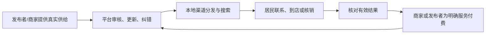

# 竹山同城：商业判断与小程序功能设计

> 2026-11-20。基于用户提供的《竹山同城 PRD》、公开可查的替代产品和现有法规资料。本文区分“文档设想”“公开证据”“待验证假设”；没有把下载量、县域商户数量或用户付费意愿当作已知事实。此文先讨论生意，再决定功能。

> 后续扩散见同目录[《竹山同城_产品机会与经营方案_v0.2.md》](./竹山同城_产品机会与经营方案_v0.2.md)：保留门店福利码作为一个入口，同时讨论回访权益、闲时名额、生活场景专题、便民需求、社区反馈和单位/小区渠道。新增玩法为候选设计，不默认全部进入第一版。

> 商家付费关系的最新细化：各店之间可直接购买推广与有效引流服务，平台提供合作、来源记录、排名与对账。详见同目录[《竹山同城_商家互相拓客与排名机制_v0.3.md》](./竹山同城_商家互相拓客与排名机制_v0.3.md)。平台自营代运营服务为可选业务。

## 一、结论

**值得做一个聚焦的竹山本地服务产品，但原 PRD 的“三合一平台”还不能证明商业闭环。** 产品的核心竞争力不应是“有便民、优惠、社区三个栏目”，而应是：居民找得到**当下有效、可信、能办成事**的本地信息和服务；商家获得**可核对的咨询或新增到店**。

把这件事做成小程序是合理的交付形式。真正难的是持续获得真实供给、分发到当地用户、审核纠错、培训商家，以及证明商家的增量收益。代码能承载这些流程，不能自动创造它们。

### 判断的证据边界

- 原 PRD 明确提出三块内容、扫码入口、优惠券、商家年费和分润；没有提供现有流量、真实付费商家、信息发布量、核销量、续费率或人工成本。
- [竹山网 App 的公开页面](https://apps.apple.com/cn/app/%E7%AB%B9%E5%B1%B1%E7%BD%91/id1079312674)已经描述生活资讯、团购、便民服务等功能；其页面显示的最近一次版本记录为 2023 年。它证明“同类定位并非空白”，但不能证明其 2026 年活跃度或市场份额。
- [58 同城的竹山招聘页面](https://www.58.com/ppeseol28269/)可见本地岗位；这说明部分分类信息有现成替代入口。搜索结果还混有外地岗位，是否构成竹山用户的实际痛点，仍需观察。
- 公开网页无法覆盖微信群、朋友圈、视频号及商家线下获客。竞争判断必须补充本地实地观察。

## 二、这个产品卖给谁、解决什么

| 客户 | 真正要完成的事 | 原 PRD 提供的能力 | 目前缺少的承诺 |
|---|---|---|---|
| 有具体需求的居民 | 尽快找到可用的房源、二手物品、服务或商家 | 分类、搜索、附近、联系 | 内容是否还有效、发布者是否可信、问题能否得到处理 |
| 想省钱的本地消费者 | 找到能兑现的优惠并方便到店 | 领券、券包、导航 | 优惠是否真实、使用条件是否清楚、商家是否认券 |
| 发信息的人 | 找到真正会联系自己的本地人 | 免费发布、置顶 | 浏览量之外有多少有效询问；发布是否简单 |
| 付费商家 | 获得新增顾客或有效咨询，少花无效推广费 | 联盟码、优惠券、看板、推荐位 | 能否证明新增，而非把原有顾客扫码算成平台成绩 |

因此，“客户”至少有两类：**使用产品的居民**与**为效果付钱的商家**。两者选择产品的理由不同。居民不会因为平台有“联盟”概念而来；商家也不会因为平台有“社区”板块就付费。

## 三、用户为什么可能选择你

居民使用新入口要比微信群滚动消息、现有本地站点和大平台更省事。可形成差异的服务标准是：

1. **新鲜：**信息展示发布时间、最近核实时间和失效状态；过期自动下架，发布者定期确认。
2. **可信：**清楚区分“商家资质已核验”“信息已人工检查”“用户自行发布”，不把付费广告包装成认证。
3. **能行动：**卡片直接给出价格、地点、条件和联系入口；优惠券规则能在到店前看清。
4. **有反馈：**虚假信息、已租已售、拒绝核销能便捷举报，并得到处理结果。
5. **局部密度高：**先在一个商圈和少数品类做到“打开就有用”，再扩到全县和乡镇。

商家选择你，理由只能是**单位投入带来的有效本地客户**比他们当前的渠道更划算、执行又更省力。你需要报告“咨询、跨店核销、商家确认的新客”，并承认扫码与领券并不等于成交。

二维码可利用商家现有到店客流，但它主要触达已有顾客；不能自动证明平台获得了新居民。小区、快递站等公共位置贴码还需要实际渠道和场地支持。

## 四、原想法中真正的商业风险

### 1. 三块业务不一定自然互相导流

找房、找工作和买二手是明确但低频的任务；优惠券依赖商家密度与实际折扣；社区发帖依赖现成关系和持续内容。一个人来看租房信息，不代表他会领取美甲券。原 PRD 把“信息流量 → 商家收入 → 社区留存”写成一条自然链，实际需要逐段验证。

**修正：**让便民信息与商家优惠各自有独立价值和结果指标。只有在场景相关时做交叉推荐，例如搬家需求对应搬家/保洁服务；不要在所有信息详情页塞泛商家广告。

### 2. 内容供给与信任是日常成本

发布表单容易开发，持续有真实、不过期的内容难。虚假租房、重复二手信息、联系方式引流、过期优惠都会损害口碑。需要明确谁每天审核、抽查、下架、回复投诉，以及每件事耗时多少。

### 3. 商家“看板”不等于商家价值

扫码多可能只是原有顾客扫了收银台码。商家关心新增到店、有效咨询、复购和毛利。原 PRD 没有定义“新客”和归因窗口，`source_shop_id` 还可能被前端传参影响。先把统计做可信，才谈联盟返佣。

### 4. 年费定价缺少成本依据

按原价格，标准版 300 元/年约 25 元/月，高级版 800 元/年约 67 元/月。若高级版含上门拍视频、文案、设计和代运营，交付成本很容易超过收入。100 家标准版加 30 家高级版，年费合计 5.4 万元，月均 4500 元，尚未扣除地推、审核、客服和开发费用。这是算术示例，不是销量预测。

### 5. 分润未形成可结算交易

扫码与券核销可以记录，但原方案没有核实消费金额、退款和客源归属。不能仅据此收取“交易额的 5%～10%”。若未来做固定核销服务费或交易分成，也要先明确结算基数、退款、作弊和争议处理。

## 五、建议的产品定位与经营路径

### 新观察：足浴店购买外地团队拓客服务

用户观察到一家小足浴店请外地团队在竹山发体验券、筛选目标顾客并约到店。**这说明至少该店愿意为拓客投入资源**，是比“商家可能需要线上曝光”更具体的需求信号。尚不知道其付费方式、到店率、成交率、复访率及最终是否赚钱，因此不能据一个案例认定异业联盟必然成立。

这条证据提高了“商家拓客服务”作为首批业务的优先级。用户随后明确了更具体的入口：**A 服装店把自己的福利二维码放在收银台或由店员向顾客展示；顾客扫码后可领取并当场核销 A 店优惠，同时看到 B 美业店、C 足浴店等合作商家的优惠券。** 第一版应先做好这个“门店福利页”，便民信息可保留为另一入口，但不作为商家互推成立的前提。

`A 店顾客看到福利码 → 扫码进入 A 店福利页 → 领取/当场核销 A 店券 → 自主查看并领取 B/C 店券 → B/C 店预约（若需）→ 到店核销 → 新客消费与复访 → 商家核对效果并续购服务`

A 店自己的券是扫码诱因，也可能帮助增加客单、促成下次到店；但如果顾客本来就要按原价买，结账时无条件发券可能只是让 A 店少收钱。券规则应明确该优惠的商业目的：当次加购、满额消费、下次回访或给忠实顾客的回馈，并记录实际成本。A 店愿意持续摆码，还需要获得可见收益：本店券使用和复访、合作店的反向导流，或在规则成熟后获得可核对的推荐回报。

B/C 店获得的是来自 A 店真实购物场景的潜在新客，而非普通线上曝光。美甲、美发、服饰、足浴等可以作为候选商家池；**是否互补要看真实顾客重叠、距离、价位、时段和接待能力，不能仅凭“女性消费”判断**。足浴的实际客群也需单独核实。服务类商家通常需要预约确认；服装等零售店可以当场使用，无需强迫走预约流程。

一个二维码带来更高的**优惠曝光**是合理假设；是否“极大提高到店率”需要按门店漏斗验证：`A 店交易人数 → 扫码人数 → A 店券当场核销人数 → B/C 券领取人数 → B/C 实际到店人数 → B/C 确认新客人数 → 付费/复访人数`。各环节分母要明确，不能把扫码量称为到店量。

顾客主动领取 B/C 券，才进入后续联系和预约。平台不把 A 店已有客户名单直接交给 B/C 店；涉及向其他商家提供个人信息时，应核实告知和单独同意要求。参考[《个人信息保护法》第二十三条](https://ynca.miit.gov.cn/zwgk/zcwj/flfg/art/2021/art_3dd0c01fb3ed49df9bf3f51a51497053.html)。

早期合作可先做**相互展示与推荐**，逐店核对成果。若商家愿意付费，可测试有明确服务范围的活动费，或按经核对的有效新客到店收费；预约未到、原有顾客、员工自刷不能算有效新客。对 B 店，要计算首次服务扣除优惠后的毛利、合理期限内复访毛利，再减去平台费用、推荐方激励和人工成本。免费体验带来的到店数若无法转成付费与复访，不构成可持续拓客。

本地团队相比一次性外地拓客团队的潜在优势，是持续维护商家关系、体验履约、重复转化和结果记录；这些需要真实地推和运营人员。美团面向[美业与足疗商家的产品](https://k.meituan.com/home)也把预约管理列为经营能力，说明该环节不能只当作券页面上的附属按钮。

**对居民的定位：**“竹山现在还有效的本地信息与优惠，找得到、联系得上、用得了。”

**对商家的定位：**“帮你接到可核对的本地咨询和到店顾客，并把无效推广成本说清楚。”

### 两条能够独立成立的业务链

- **信息链：**真实、及时的信息带来有效联系；发布者获得回应，愿意再次发布。之后可以销售明确标注的推广位或商家服务，但不能出售“真实认证”本身。
- **商家链：**A 店福利码激励顾客扫码；A 店券当场兑现；顾客领取 B/C 店券并到店；各店核对自身收益，愿意继续参与或为下一期拓客服务付费。平台把收入投入物料、商家运营和分发。
- **连接点：**仅在居民任务与商家服务相关时互推。两条链若没有交叉转化，也可以分别经营，不应把虚构的互推效果记入商业模型。

### 收费顺序

1. **先有交付：**基础信息浏览和商家展示可免费，确保供给；收费服务要写明展示位置、时长、制作次数、周报与客服范围。
2. **再验证付费：**以月或季为单位测试商家推广/代运营服务的真实付款和续费，价格基于交付成本与商家可确认收益调整。原 300/800 元年费保留为待验证假设。
3. **后做增值：**首页推荐、置顶、物料制作、短视频拍摄可单独定价。所有广告明确标注；优先级不覆盖真实性与新鲜度规则。
4. **最后考虑分润：**只有交易和归因均能被商家核对、且退款与争议机制成立，才自动结算。社区先解决留存任务，不作为早期收费点。

**单位经济核算：**月收入＝实收商家服务费＋活动/推广收入＋其他已验证收入；月可变成本＝地推、内容审核、客服、商家培训、物料、支付与云资源；每月还要覆盖开发和管理固定成本。核心看实际收款、续费和单商家贡献毛利，而非 DAU 或发券数。

## 六、从商业价值反推小程序功能

| 业务承诺 | 第一版功能 | 对应验证指标 |
|---|---|---|
| 本地信息当下有效 | 分类/地区搜索、最近核实时间、过期提醒、发布者续期、举报与审核 | 有效信息比例、联系成功率、过期/虚假投诉率 |
| 找信息后能办事 | 详情页突出价格、地点、条件、直接联系；相关服务推荐 | 有效咨询数、任务完成回访 |
| 优惠能够兑现 | 明确券规则、领券、服务类优惠预约、券包、员工核销、拒兑投诉 | 预约确认率、到店率、优惠兑现率、投诉量 |
| 商家看到真实效果 | 区分扫码、领券、预约、到店、核销、确认新客；商家可核对明细 | 确认新客数、首访消费/复访（商家自愿回填）、实际付款/续费 |
| 平台能持续运营 | 管理后台审核、到期巡检、商家培训记录、投诉处理、数据导出 | 每条审核耗时、投诉处理时长、每商家运营成本 |

**第一版首页：**搜索和地区入口优先，其次是有内容密度的 1～2 个高需求分类，再展示明确标注的本地优惠。页面不要同时塞九宫格、推荐流、附近流、联盟卡、社区动态和活动横幅，使用户找不到当前任务。

**第一版商家页：**营业信息、地址、服务、优惠规则、确认状态、到店路线与投诉入口。商家数据看板显示来源和有效动作，不展示未经核实的“成交额”。

**第一版运营后台：**不只是财务大屏。优先把审核、过期信息、拒兑/虚假举报和商家服务记录做成待办队列。这是承诺“可信、有效”的必要功能。

**社区的进入条件：**已有稳定用户访问、明确的本地讨论主题和持续管理员。可先从信息详情的问答、经验补充或活动讨论切入；泛“邻里圈”会要求大量内容与治理，不宜作为初期增长发动机。

**绿松石的进入条件：**先界定是本地商家黄页、资讯、鉴定线索还是交易。它面向县外用户的逻辑与县内便民服务不同，需单独验证供给、鉴定信任和纠纷责任。

## 七、启动方式由现有资源决定

| 如果现在最强的资源是… | 首页与首批供给应偏向… | 优先验证 |
|---|---|---|
| 已有活跃本地群、公众号或信息发布者 | 一个需求强且能维护真实性的便民分类 | 是否比群消息更快找到有效信息；发布者是否反复使用 |
| 已有 10 家以上可合作商家和线下地推人手 | 一个商圈的商家优惠与跨店互推 | 是否产生经商家认可的新客；是否有人实际付费 |
| 两类资源都薄弱 | 先做可扩展的产品骨架，同时建立一个具体的供给与分发渠道 | 能否持续取得真实内容和实际用户入口 |

这三条是资源条件下的不同启动顺序，不是三个产品都要同时运营。小程序可以统一承载，但首页主任务和运营预算应只有一个重心。

## 八、目前最需要补齐的事实

1. 现有本地用户入口：微信群、公众号、视频号、线下门店，各能触达多少真实竹山居民？
2. 可直接合作的商家数量、品类、地理分布；他们现在靠什么获客、花多少钱？
3. 谁负责每天审核、联系发布者、商家培训、投诉处理？每周可投入多少小时？
4. 用户最常问的 2～3 类事情，现有渠道是否有“信息过期、联系不上、真假难辨”的具体案例？
5. 小程序主体和招聘类业务资质。招聘发布不能按普通帖子直接上线；参考[人社部对网络平台招聘信息的要求](https://www.mohrss.gov.cn/wap/xw/rsxw/202601/t20260113_565374.html)。

在这些信息出现前，判断为：**需求方向有合理性，差异化和付费闭环尚未被证实。开发应围绕“信息有效、优惠兑现、结果可核对”的核心流程展开，而不是按栏目数量推进。**
